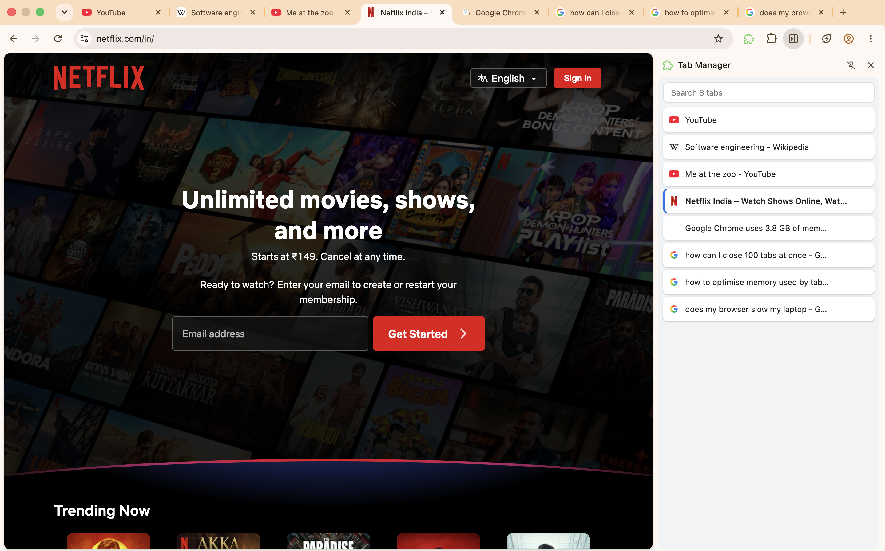

# Tabbernate

A Chrome extension that lists all your open tabs in the side panel, so you can search, switch, close, and put tabs to sleep to free up memory.



## Features

- **All tabs at a glance**: every open tab across all windows, with favicons, in a side panel that stays open while you browse
- **Live updates**: the list stays in sync as tabs are opened, closed, switched, or reordered
- **Search**: filter tabs instantly by title or URL
- **Sort**: by tab order, most or least recently used, or awake tabs first
- **Last used**: each tab shows how long ago you last used it ("5m", "3h", "2d")
- **Switch**: click any tab to jump to it
- **Close**: close a tab right from the list
- **Sleep**: unload a tab to free its memory without closing it; it stays in your tab strip and reloads when you open it again
- **Light and dark mode**: follows your system theme

## Tech stack

- [WXT](https://wxt.dev): web extension framework
- React + TypeScript
- Chrome Extensions API (Manifest V3): `tabs`, `sidePanel`

## Getting started

### Prerequisites

- Node.js 18+
- Google Chrome

### Run in development

```bash
npm install
npm run dev
```

This opens a Chrome window with the extension loaded and reloads it automatically when you save changes.

### Build and load manually

```bash
npm run build
```

1. Open `chrome://extensions`
2. Turn on **Developer mode** (top right)
3. Click **Load unpacked** and select the `.output/chrome-mv3` folder
4. Click the extension's toolbar icon to open the side panel

### Run tests

```bash
npm test
```

## Project structure

```
entrypoints/
  background.ts       # service worker: opens the side panel on icon click
  sidepanel/
    App.tsx           # wires state to components; no tab logic of its own
    App.css
components/           # presentational UI: Toolbar, TabList, TabTile, Favicon, icons
hooks/
  useTabs.ts          # live list of open tabs
  useNow.ts           # current time, refreshed every minute
services/
  tabService.ts       # the only module that calls the browser tabs API
utils/
  tabs.ts             # pure logic: filtering, sorting, formatting
tests/
  tabs.test.ts        # unit tests for utils/tabs.ts
wxt.config.ts         # extension config and permissions
```

The code is layered so each part has one job: **utils** hold pure, unit-tested logic; **services** wrap the browser API; **hooks** connect the two to React state; **components** only render and receive callbacks.

## Roadmap

- [ ] Detect stale tabs (not used in a while) and sleep or close them in bulk
- [ ] Find and merge duplicate tabs
- [ ] Group tabs by domain, with "close all" per group
